# C-07 / PR #13 — visuaalisen katselmoinnin korjauskierros

**Tila: ehdokas käyttäjän visuaaliseen tarkastukseen, ei hyväksytty eikä julkaistu.** Korjaus jatkaa PR #13:n samaa haaraa `feature/issue12-c07-art-pilot` ja alkuperäistä Blender-lähdettä commitista `e4c80525ac7ef5320eeecda54839b41d909b24a6`. Telakkaan tai asemaan ei ole laajennettu.

Lähtökohtana on PR #13:n riippumaton *Independent C-07 visual QA (26.10.2026)*, jonka päätös oli **VISUAL NO-GO**. Alkuperäinen käyttäjän toimittama `03_c07_aluksen_referenssi.jpg` tarkastettiin uudelleen. Konseptin olennaisia piirteitä ovat voimakas ohjaamo, erilevyiset osittain päällekkäiset suojarakenteet, tummaan runkoon upotettu rahti ja koneistoon liittyvät moottorit. Kuvakulmat eivät ole täsmällisiä keskenään yhteneviä CAD-projektioita.

## Ennen / jälkeen — sama Godot-studio

Vasen kuva: katselmoitu `e4c8052`. Oikea: tämän korjauskierroksen GLB. Kaikki kuvat ovat oikeita 1440 × 1000 **Godot 4.7.2 Compatibility** -viewport-tallenteita. Niitä ei ole retusoitu. Studiovalot, ortografinen projektio, kameran suunnat ja mittarajoihin sovittava rajausalgoritmi ovat samat. Uuden mallin noin 7 mm leveysmuutos vaikuttaa automaattiseen rajaukseen vähäisesti; kuvia ei ole venytetty pikselikohdistusta varten.

| Ennen | Jälkeen |
| --- | --- |
|  | 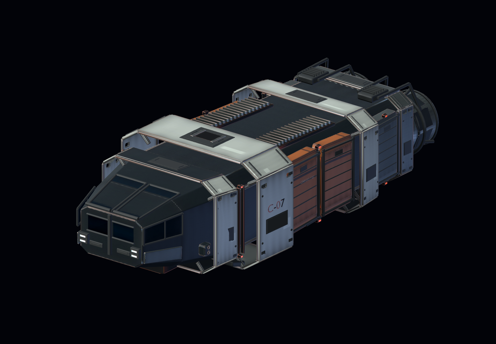 |
| 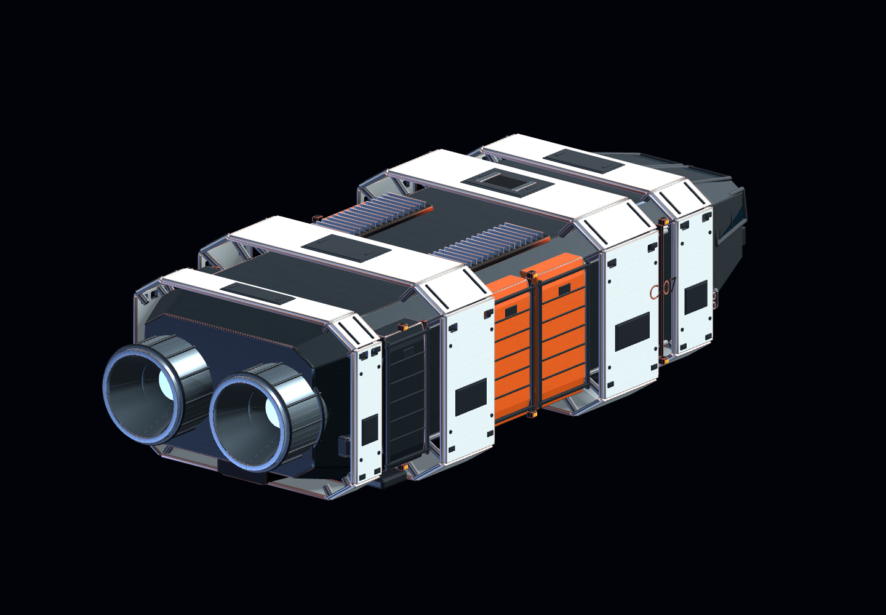 | 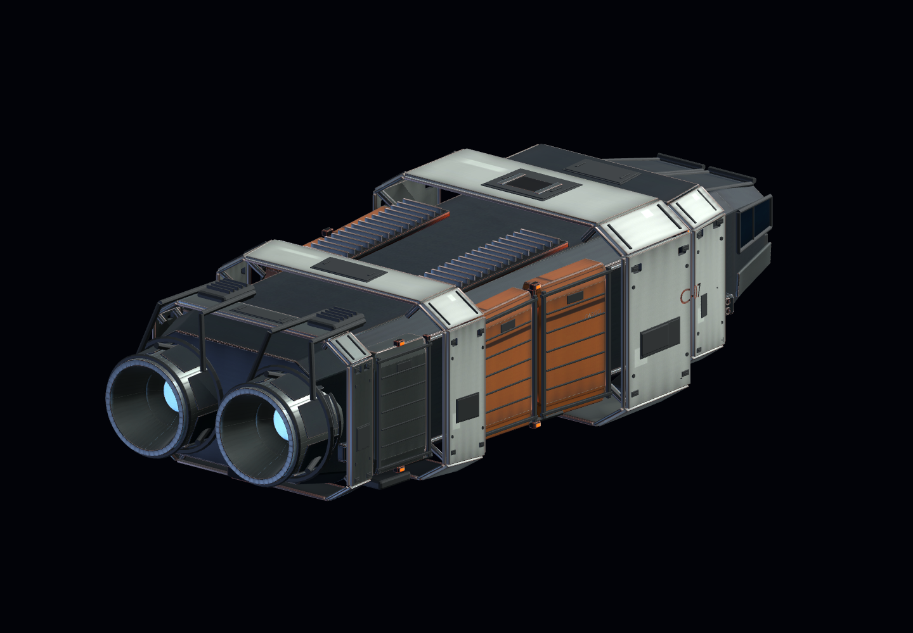 |
| 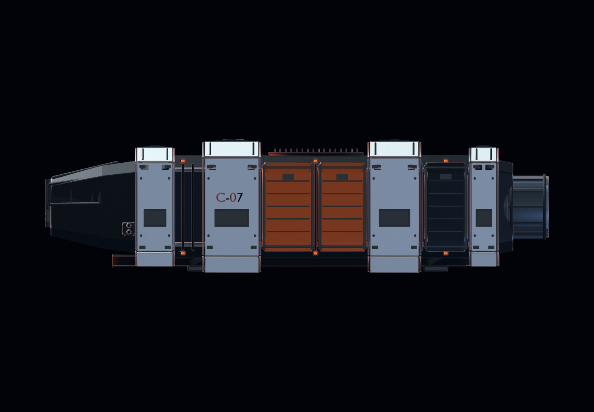 | 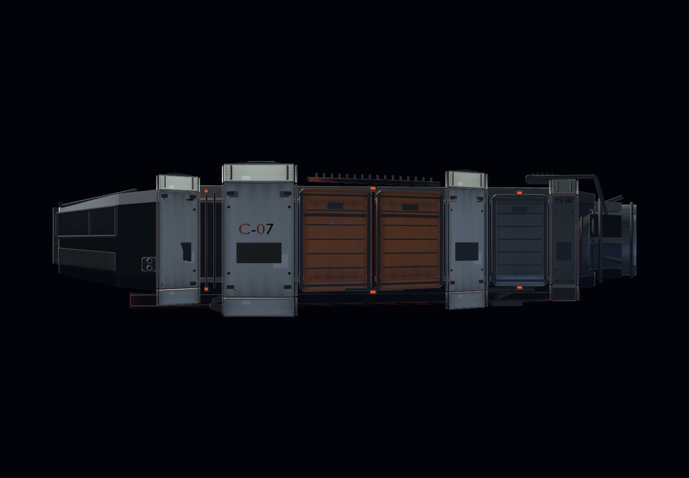 |
| 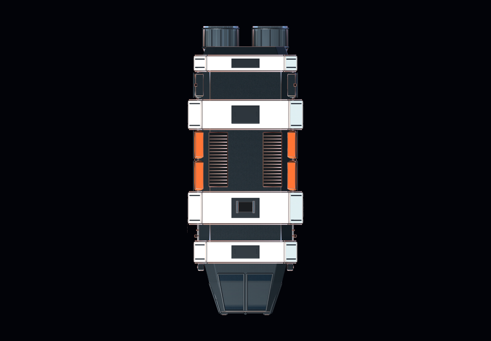 | 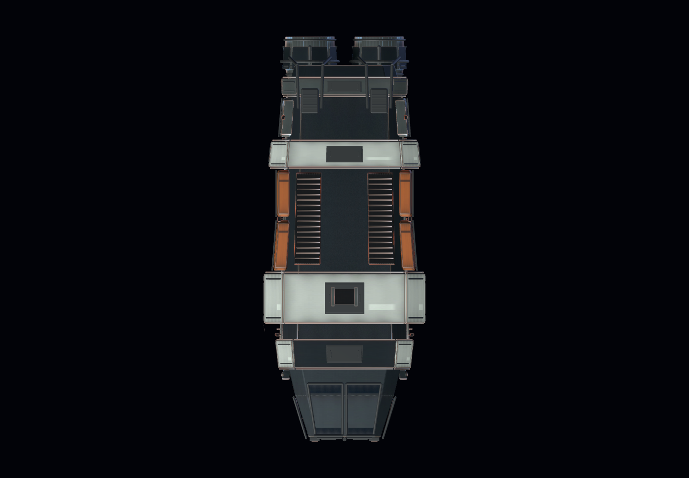 |
| 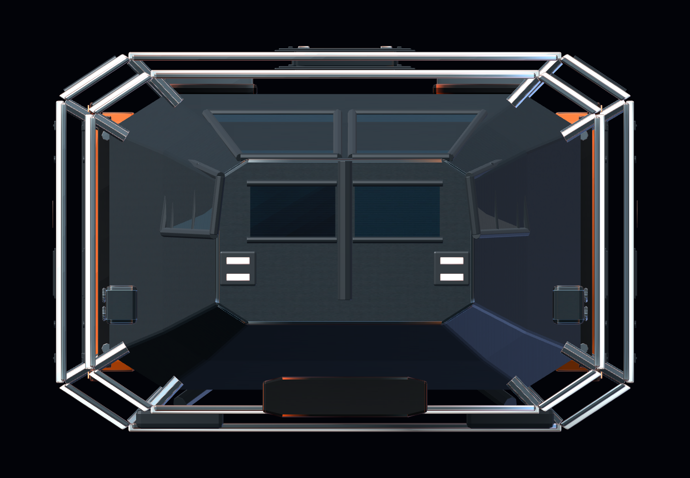 | 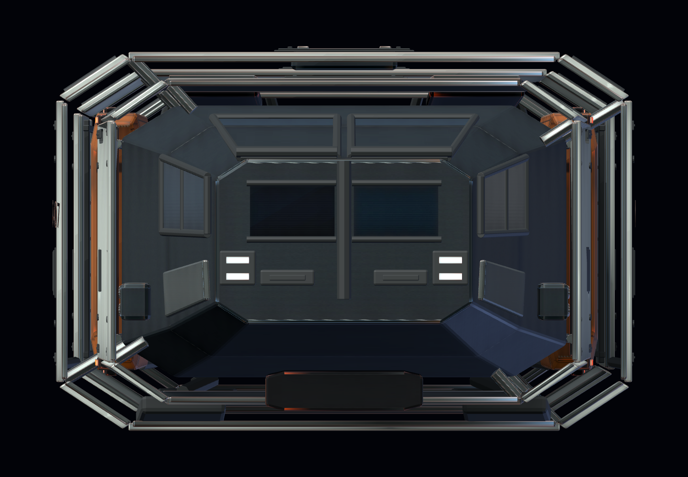 |
| 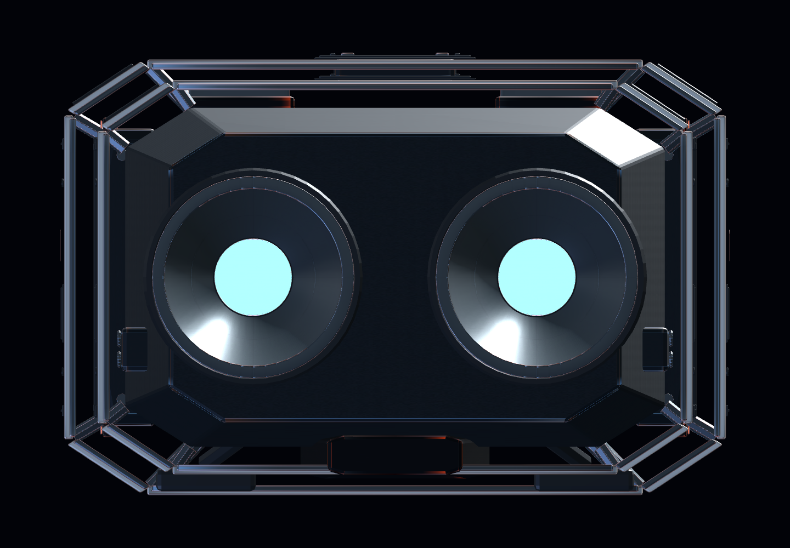 | 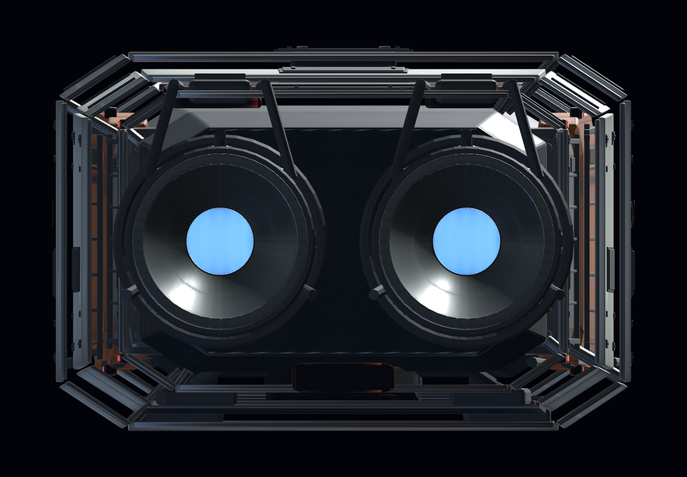 |

## Samat mallit pelin omassa valaistuksessa

Kuvausskripti kutsuu **olemassa olevaa `main.gd::_build_lights()`-funktiota**, ei arviolta kopioituja arvoja. Pelilogiikkaa tai tallennusta ei käynnistetä. Tässä tilassa studiovalot ja studioheijastukset poistetaan. Näkymä ei ole gameplay-integraatio tai Android-suorituskykytesti.

| Ennen, pelin valaistus | Jälkeen, pelin valaistus |
| --- | --- |
| 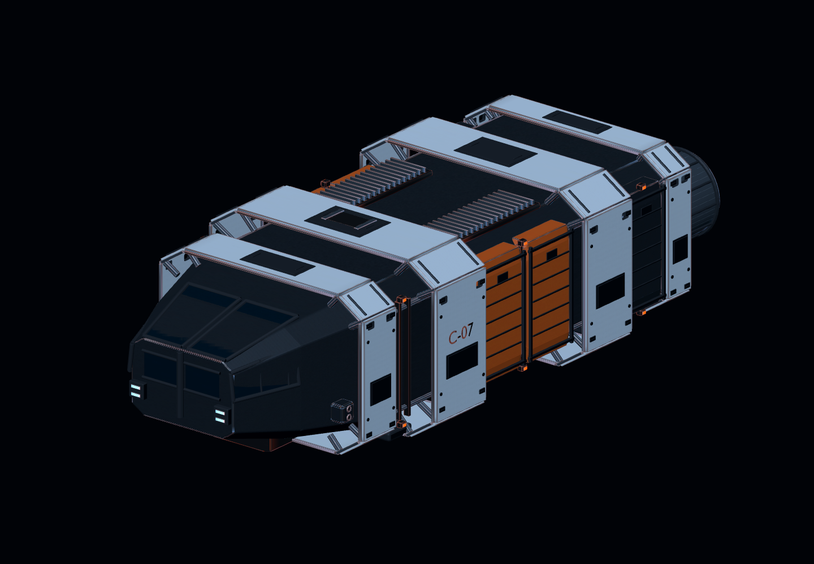 | 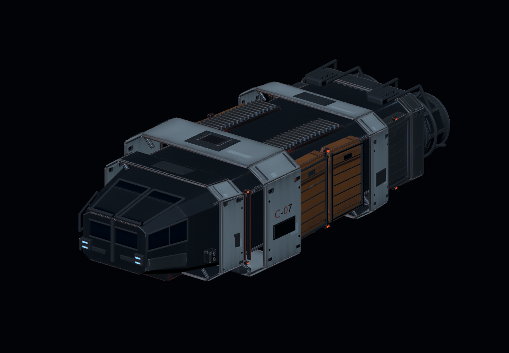 |
| 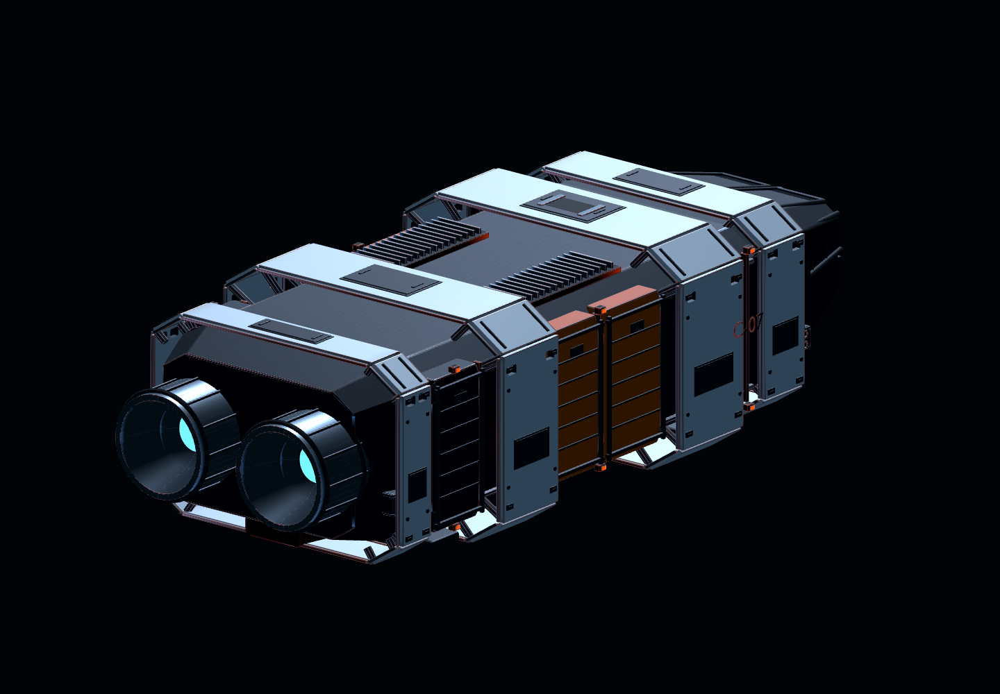 | 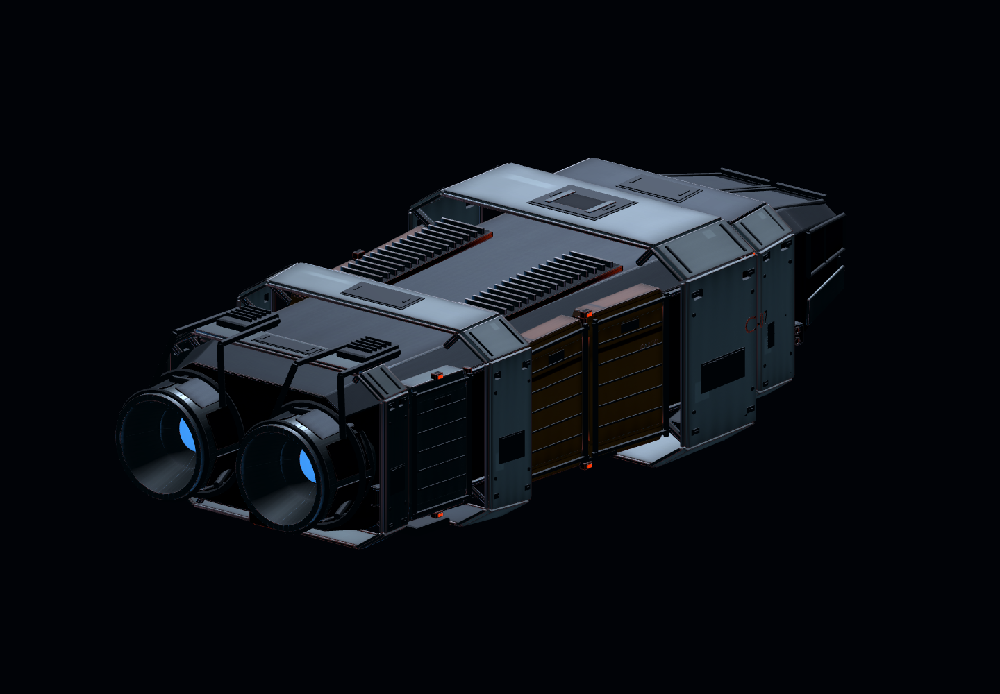 |

## Kohdennetut muutokset

| Katselmoinnin havainto | Korjaus samaan lähteeseen |
| --- | --- |
| Tasarytmiset kirkkaat kehät | Etummaisen rahtiosan suojarakenne on pidempi ja leveämpi, takaosan olake lyhyempi ja kapeneva. Ohjaamon yläpanta ja perän suojat ovat tummaa rakennetta; kaikki neljä rengasta eivät enää muodosta samanarvoisia valkoisia raitoja. |
| Laatikkomaiset ylä-/sivuprofiilit | Koko olemassa oleva runko ja sen kiinnikkeet muotoiltiin yhtenäisesti eri levyisiin ohjaamo-, rahti- ja koneisto-osiin. Rahtiosan pituussuuntainen kuormapolku korostuu, perä kapenee. |
| Liian puhdas materiaali | Alkuperäiset neljä pakattua karttaa muokattiin: murrettu maalipinta, vähemmän kylläinen rahti, saumoihin sidottu lika ja kuluma, paikattu maali sekä vaihteleva karheus. Yksi tarkoituksellinen vaihdettu huoltokansi rikkoo peilisymmetrian. |
| Yksinkertainen ohjaamo | Alkuperäiset sivulasit siirrettiin ulos runkoon leikkautuvasta asennosta. Uudet lasin kehykset/separaattorit, otsasuojus, kerrokselliset poskilevyt ja anturisyvennykset muodostavat luettavan keulan. |
| Irralliset moottorikellot | Alkuperäiset kaksi suutinta säilyivät. Niitä ympäröivät nyt gimbaalilaakerit, työntövoimatuet, toimilaitetangot, näkyvät syöttöputket, jäähdyttävät huoltolohkot ja segmentoitu lämpösuoja. Piiloon jääneet ensimmäiset putkireitit siirrettiin renderin perusteella näkyvään huoltotilaan. |

479 alkuperäistä nimettyä mesh-objektia säilyi. Muokkauksessa poistettiin päällekkäisiä tukia, toistuvaa hienoa moottoriputkitusta ja vanhat lasiin huonosti osuneet kehykset. Uudet osat liittyvät havaittuihin toiminnallisiin puutteisiin; muotoa ei rakennettu uudestaan vanhan lähteen tilalle. Deformaation jälkeen split-normaalit laskettiin uudelleen.

## Toimitus, jäljitettävyys ja budjetti

- [Päivitetty muokattava `.blend`](../../native-prototype/art/c07/source/c07_courier.blend) ja [tuotanto-GLB](../../native-prototype/production/models/c07_courier.glb).
- [Muokkausskripti](../../native-prototype/art/c07/revise_c07.py) avaa SHA-lukitun alkuperäisen lähteen. [Lähdeobjektien säilyminen ja poistot](../../native-prototype/art/c07/revision_lineage.json).
- [Alkuperä ja SHA-256](../../native-prototype/production/asset_manifest.json), [Blender-mittarit](../../native-prototype/art/c07/build_metrics.json), [Godot-mittarit](godot-metrics.json), [pelivalon mittarit](game-lighting/godot-metrics.json), [testit ja kuvien tarkisteet](validation.json).
- [Toistamisohjeet](../../native-prototype/art/c07/README.md). Referenssikuvia ei ole käytetty tekstuureina eikä julkaistu tässä repositoriossa.

| Mitattu tieto | Ennen | Jälkeen |
| --- | ---: | ---: |
| Pituus × leveys × korkeus, Godot-metreinä | 29,86 × 12,036 × 7,96 | 29,86 × 12,043 × 7,96 |
| LOD0-kolmiot | 84 744 | 87 572 |
| Runtime-meshit / materiaalit | 13 / 1 | 13 / 1 |
| Muokattavat lähdeobjektit | 547 | 556 |
| PBR-kartat | 4 × 1024² | 4 × 1024² |

## Testaus ja rajat

Lopulliset paluukoodit sekä kuvien ja mallien tarkisteet ovat `validation.json`:ssa. **Python: 12 PASS / 0 FAIL / 0 SKIP. Node: 9 PASS / 0 FAIL / 0 SKIP.** Blender-, Godot-, preview-, docking- ja hero-tarkistukset PASS; kuusi studio- ja kaksi pelivalon renderöintiä PASS. GitHubin tämän revision CI:tä ei ole varmennettu. Testit kattavat Python-intake/GLB-sopimuksen, alkuperäiset Node-testit, Blender-lähteen, puhtaan Godot-importin, kuusi studiokuvakulmaa, kaksi pelivalokuvakulmaa sekä olemassa olevat preview-, docking- ja hero-smoke-testit. Uudet tarkistukset todistavat lähteen jatkuvuuden, etu-/takaolakkeiden kokoeron, perän materiaalijaon, propulsion-rakenteet ja roughness-vaihtelun. Aiemmat 100 000 kolmion, 20 surfacen, mittojen ja kuvauksen marginaalien rajat säilyvät.

Kehityksessä löytyi myös kuvasta todennettu puute: ensimmäiset moottorimanifoldit jäivät kuoren sisään. Osat sijoitettiin uudelleen; niiden olemassaolotesti ei yksin osoittanut korjauksen näkyvyyttä. Materiaalit ja geometria tarkastetaan siksi aina myös toimituskuvista.

**Tekninen PASS ei ole visuaalinen GO.** Kuvissa voi edelleen näkyä laajoja tasaisia pintoja ja toistuvia atlas-yksityiskohtia. Ohjaamon lasi on opaakkia, sisustusta ei ole. Pelin omassa valaistuksessa tumma koneisto ja lasit jäävät studiota heikommin erottuviksi; tätä ei korjattu piilottamalla ongelmaa lisävalolla. Pienet putket, lämpösuojat ja LOD-siirtymät tarvitsevat myöhemmin Android-tarkastuksen. Desktop-kuvat tuotettiin Mesa-ohjelmistorenderöinnillä; Android/Mobile-renderöijän FPS:ää, frame-timea tai lämpenemistä ei ole mitattu.

PR pysyy Draft-tilassa, `review_status=candidate` ja `release_approved=false`. Ei mergeä, julkaisua, pelilogiikan muutoksia tai laajennusta telakkaan. **Seuraava portti on käyttäjän visuaalinen arvio tästä ennen/jälkeen-aineistosta.**
