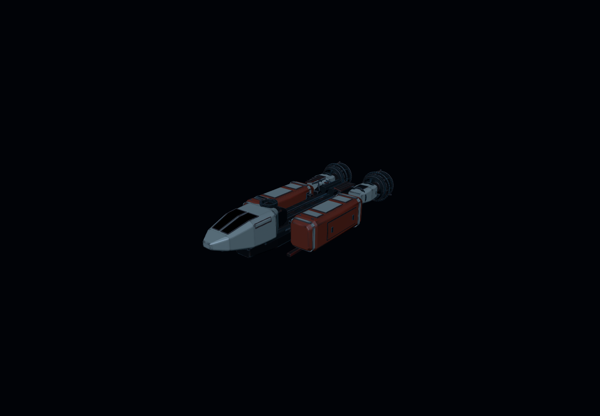
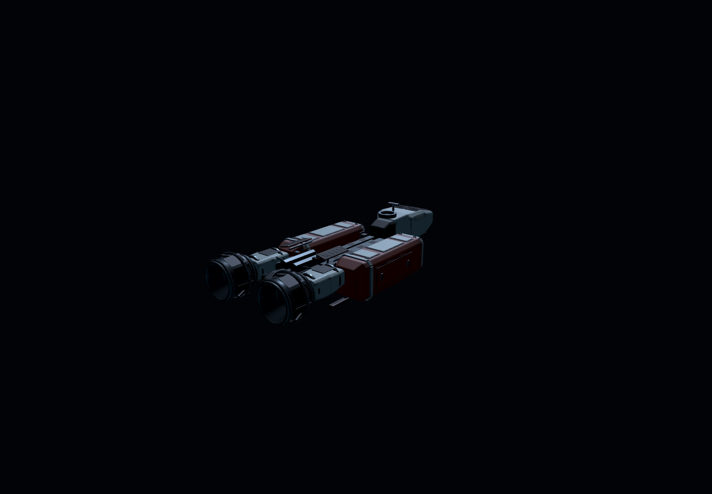
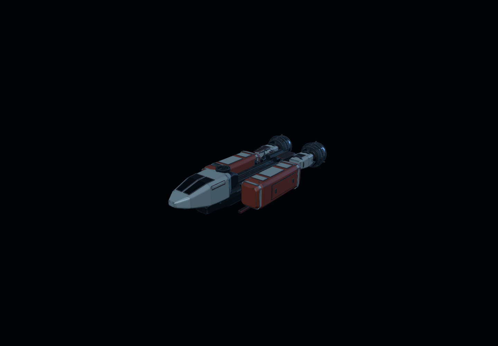
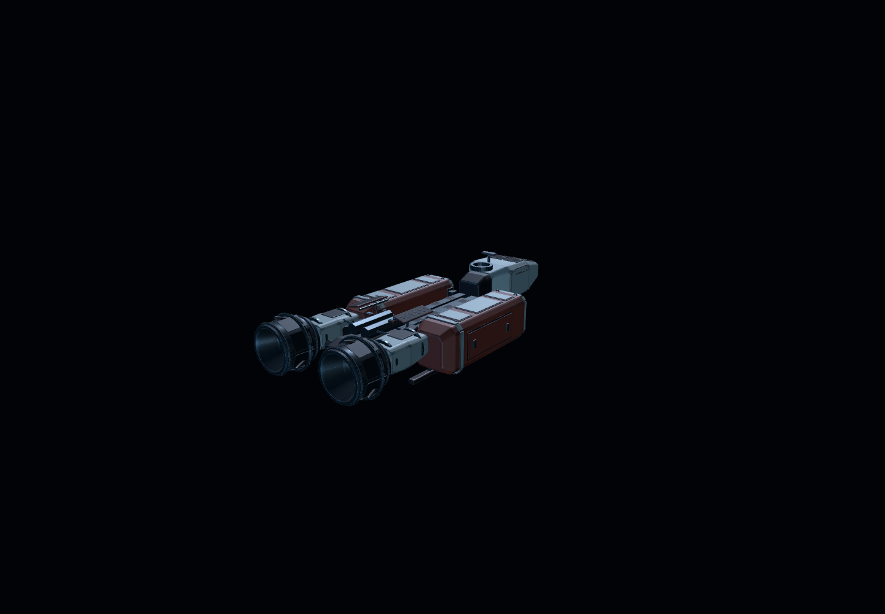
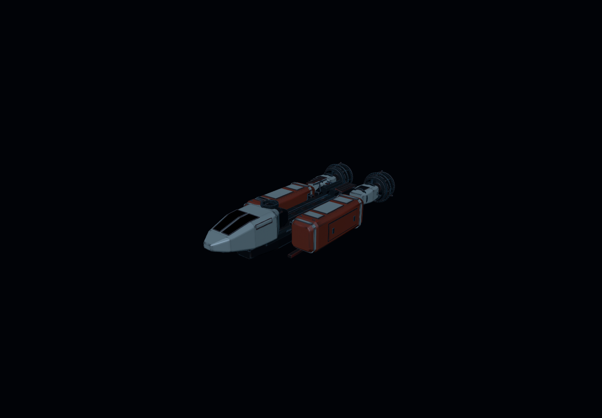
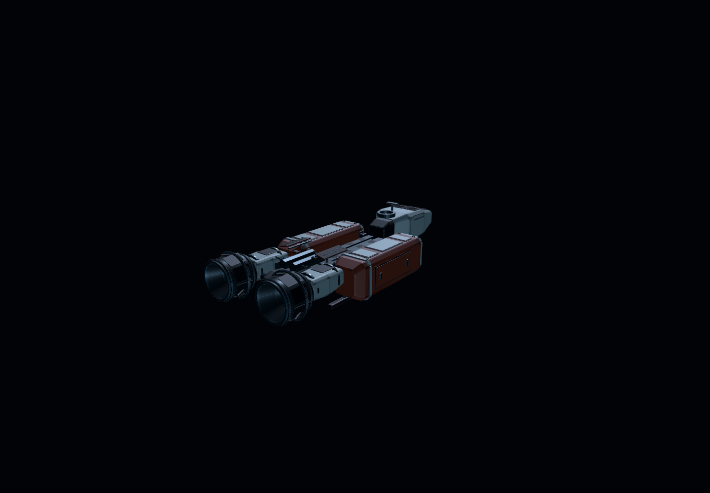
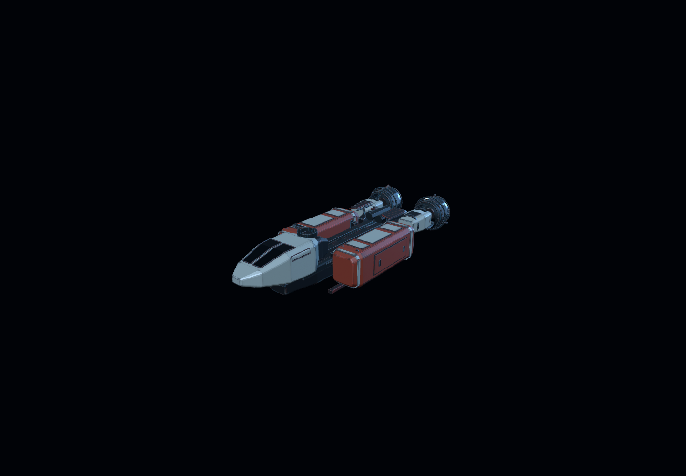
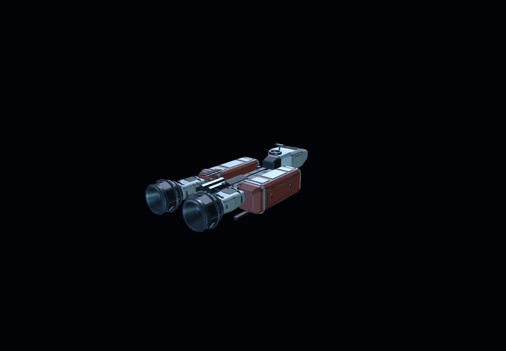

# C-07 A4 – automaattiset valaistuskuvat

**Godot 4.7.2 / Linux / GL Compatibility.** Nämä ovat **oikeasta GLB-3D-mallista** automaattisesti renderöidyt Godot-kuvat, **eivät Android-emulaattorin kuvankaappauksia** tai tekoälyn generoimia konseptikuvia. Kuvakulmat, kamera, malli ja materiaalit pysyivät muuttumattomina. Vain valotila muuttui.

| Valaistustila | Etuviisto | Takaviisto |
| --- | --- | --- |
| **PELI** (alkuperäinen) |  |  |
| **TASAPAINO** (uusi kokeilu) |  |  |
| **TARKASTUS** (vanha kirkkaampi tarkastus) |  |  |
| **HERO** (vahvempi suunnattu valo) |  |  |

### Ensimmäinen katselmointi
Edellinen TASAPAINO jäi liian tummaksi. HERO-testissä päävalo on selvästi vahvempi ja moottorien varjokoloa avataan tilapäisellä telakkamaisella heijastusvalolla. Valaistus on testiasetus, ei hyväksytty pelin pysyvä valaistus. Tuloksen arviointi tehdään kuvia vertaamalla. Erillinen Android Mobile -laitetesti tarvitaan suorituskyvyn ja mobiilin todellisen kuvan tarkistamiseen.

Kuvat tuotti [c07-a4-lighting-screenshots.yml](../../../.github/workflows/c07-a4-lighting-screenshots.yml). Kuvausparametrit, aluksen SHA256 ja renderöintialusta löytyvät [capture-manifest.json](capture-manifest.json)-tiedostosta.
